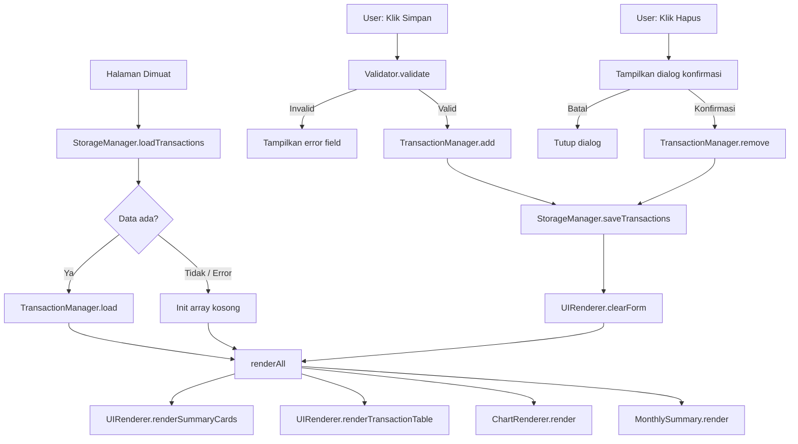

# Design Document

## Overview

Expense & Budget Visualizer adalah aplikasi web finansial personal berbasis browser yang dibangun sepenuhnya dengan HTML5, CSS3, dan Vanilla JavaScript. Aplikasi berjalan sebagai **Single-Page Application (SPA)** tanpa framework — navigasi antar-bagian dilakukan dengan menyembunyikan/menampilkan elemen DOM secara langsung, bukan dengan perpindahan URL.

Semua data disimpan di **Browser Local Storage** agar persisten tanpa server backend. Visualisasi data menggunakan **Chart.js via CDN** untuk menampilkan distribusi pengeluaran per kategori dalam bentuk pie chart. Antarmuka berupa modern financial dashboard dengan sidebar navigasi vertikal, summary cards, tabel transaksi, form input, dan dukungan dark/light mode.

**Prinsip arsitektur utama:**
- Zero dependencies (kecuali Chart.js via CDN)
- Single file per tipe: 1 HTML, 1 CSS, 1 JS
- Semua logika bisnis terenkapsulasi dalam modul-modul JavaScript di `app.js`
- UI reaktif: setiap perubahan data langsung memperbarui semua tampilan terkait tanpa reload halaman

---

## Architecture

### Pola Arsitektur

Aplikasi menggunakan pola **Module Pattern** dalam satu file JavaScript, dengan pendekatan reactive sederhana: setiap operasi data memanggil fungsi `renderAll()` yang memperbarui seluruh tampilan.

```
┌─────────────────────────────────────────────────────────┐
│                        index.html                        │
│  (Entry point, struktur DOM, referensi CSS & JS CDN)     │
└─────────────────────────────────────────────────────────┘
              │
              ▼
┌─────────────────────────────────────────────────────────┐
│                      css/style.css                       │
│  CSS Variables (tema), layout, komponen, media queries   │
└─────────────────────────────────────────────────────────┘
              │
              ▼
┌─────────────────────────────────────────────────────────┐
│                       js/app.js                          │
│                                                          │
│  ┌────────────────┐   ┌─────────────────────────────┐   │
│  │ StorageManager │   │      TransactionManager      │   │
│  │  (R/W Local    │◄──│  (tambah, hapus, baca, sort) │   │
│  │   Storage)     │   └──────────────┬──────────────┘   │
│  └────────────────┘                  │                   │
│                                      ▼                   │
│  ┌─────────────┐    ┌────────────────────────────────┐  │
│  │  Validator  │    │          UIRenderer             │  │
│  │  (validasi  │    │  (Summary Cards, Tabel, Form)   │  │
│  │  form input)│    └───────────────┬────────────────┘  │
│  └─────────────┘                    │                   │
│                                     ▼                   │
│  ┌────────────────┐  ┌──────────────────────────────┐  │
│  │ ChartRenderer  │  │    NavigationController       │  │
│  │  (Chart.js     │  │  (SPA routing, hamburger)     │  │
│  │  pie chart)    │  └──────────────────────────────┘  │
│  └────────────────┘                                     │
│                                                          │
│  ┌────────────────┐  ┌──────────────────────────────┐  │
│  │ ThemeController│  │      MonthlySummary           │  │
│  │  (dark/light   │  │   (filter per bulan/tahun)    │  │
│  │  toggle)       │  └──────────────────────────────┘  │
│  └────────────────┘                                     │
└─────────────────────────────────────────────────────────┘
```

### Alur Data

```
User Action
    │
    ▼
Validator.validate(formData)
    │ valid
    ▼
TransactionManager.add(transaction)
    │
    ▼
StorageManager.save(transactions)
    │
    ▼
renderAll()
    ├── UIRenderer.renderSummaryCards()
    ├── UIRenderer.renderTransactionTable()
    ├── ChartRenderer.render()
    └── MonthlySummary.render()  [opsional]
```

### Reactive Update Strategy

Karena tidak menggunakan framework reaktif, setiap perubahan data memanggil `renderAll()` yang berjalan di bawah 300ms untuk data di bawah 10.000 transaksi. Ini memenuhi constraint performa dari requirements tanpa kompleksitas Virtual DOM.

---

## Components and Interfaces

### 1. StorageManager

Bertanggung jawab atas semua operasi baca/tulis ke `localStorage`.

```javascript
StorageManager = {
  KEYS: {
    TRANSACTIONS: 'evb_transactions',
    THEME: 'evb_theme'
  },
  loadTransactions(): Transaction[],   // Returns [] jika tidak ada / parse error
  saveTransactions(transactions: Transaction[]): void,
  loadTheme(): 'light' | 'dark',      // Returns 'light' jika tidak ada
  saveTheme(theme: 'light' | 'dark'): void
}
```

**Keputusan desain:** Semua operasi storage terpusat di satu modul untuk memudahkan penggantian mekanisme penyimpanan di masa depan (misalnya IndexedDB).

### 2. TransactionManager

Mengelola state daftar transaksi di memori dan mendelegasikan persistensi ke StorageManager.

```javascript
TransactionManager = {
  transactions: Transaction[],         // State in-memory
  load(): void,                        // Baca dari Storage ke memori
  add(data: TransactionInput): Transaction,
  remove(id: string): void,
  getAll(): Transaction[],
  getSorted(key: 'date' | 'amount', direction: 'asc' | 'desc'): Transaction[],
  getTotalAmount(): number,
  getTotalByCategory(category: Category): number,
  getByMonthYear(month: number, year: number): Transaction[]
}
```

### 3. Validator

Memvalidasi data input form sebelum transaksi dibuat. Mengembalikan objek hasil validasi, bukan melempar exception.

```javascript
Validator = {
  validate(formData: FormData): ValidationResult,
  validateName(name: string): FieldResult,
  validateAmount(amount: string): FieldResult,
  validateCategory(category: string): FieldResult,
  validateDate(date: string): FieldResult
}

// Types:
ValidationResult = { valid: boolean, errors: { [field]: string } }
FieldResult      = { valid: boolean, error?: string }
```

**Aturan validasi:**
| Field     | Aturan |
|-----------|--------|
| name      | Tidak boleh kosong / hanya spasi; maks 100 karakter |
| amount    | Angka positif; rentang 1 – 999.999.999.999 |
| category  | Harus salah satu dari "Food", "Transport", "Fun" |
| date      | Format YYYY-MM-DD; tidak boleh melebihi hari ini |

### 4. ChartRenderer

Membungkus integrasi Chart.js. Menyimpan referensi instance aktif untuk dihancurkan sebelum render ulang.

```javascript
ChartRenderer = {
  chartInstance: Chart | null,
  COLORS: { Food: string, Transport: string, Fun: string },
  render(transactions: Transaction[]): void,  // destroy lalu create baru
  destroy(): void,
  showEmptyState(): void  // tampilkan teks "Belum ada data untuk ditampilkan"
}
```

**Keputusan desain:** Instance Chart.js di-destroy setiap kali data berubah (bukan di-update) untuk menghindari bug animasi dan kebocoran memori yang umum terjadi saat data kategori berubah drastis.

### 5. UIRenderer

Bertanggung jawab atas semua manipulasi DOM untuk Summary Cards, Transaction Table, dan form.

```javascript
UIRenderer = {
  renderSummaryCards(transactions: Transaction[]): void,
  renderTransactionTable(transactions: Transaction[], sortKey, sortDir): void,
  renderEmptyState(): void,
  clearForm(): void,
  showFieldError(fieldId: string, message: string): void,
  clearFieldErrors(): void,
  formatCurrency(amount: number): string  // → "Rp 1.250.000"
}
```

**Format mata uang:**
```javascript
// Contoh implementasi formatCurrency
function formatCurrency(amount) {
  return 'Rp ' + Math.floor(amount)
    .toLocaleString('id-ID', { maximumFractionDigits: 0 });
}
```

### 6. NavigationController

Mengelola navigasi SPA dan perilaku hamburger menu pada mobile.

```javascript
NavigationController = {
  currentSection: 'dashboard' | 'transactions',
  init(): void,
  navigateTo(section: string): void,  // show/hide section
  toggleSidebar(): void,              // hamburger toggle
  closeSidebar(): void,               // klik luar sidebar
  updateActiveLink(section: string): void
}
```

**Keputusan desain:** Navigasi menggunakan `data-section` attribute pada elemen, bukan manipulasi `window.location`, mempertahankan single-page behavior tanpa perubahan URL.

### 7. ThemeController (Opsional — Requirement 12)

```javascript
ThemeController = {
  currentTheme: 'light' | 'dark',
  init(): void,          // Baca dari storage, terapkan ke <body>
  toggle(): void,        // Ganti tema dan simpan ke storage
  apply(theme): void     // Set data-theme attribute pada <body>
}
```

### 8. MonthlySummary (Opsional — Requirement 11)

```javascript
MonthlySummary = {
  selectedMonth: number,  // 1-12
  selectedYear: number,
  init(): void,
  render(transactions: Transaction[]): void,
  getFilteredTotals(): { Food: number, Transport: number, Fun: number, total: number }
}
```

---

## Data Models

### Transaction Object

```typescript
interface Transaction {
  id: string;        // Contoh: "1700000000000" — Date.now().toString()
  name: string;      // Maks 100 karakter, non-empty setelah trim
  amount: number;    // Integer atau float; rentang [1, 999_999_999_999]
  category: Category;
  date: string;      // Format: "YYYY-MM-DD"
}

type Category = "Food" | "Transport" | "Fun";
```

### Storage Schema

```
localStorage["evb_transactions"] = JSON.stringify(Transaction[])
localStorage["evb_theme"]        = "light" | "dark"
```

**Contoh nilai storage:**
```json
[
  {
    "id": "1700000000001",
    "name": "Makan siang",
    "amount": 25000,
    "category": "Food",
    "date": "2024-11-15"
  },
  {
    "id": "1700000000002",
    "name": "Ojek online",
    "amount": 12000,
    "category": "Transport",
    "date": "2024-11-15"
  }
]
```

### CSS Theme Variables

```css
:root {
  /* Light theme (default) */
  --color-primary:    #4F46E5;
  --color-accent:     #7C3AED;
  --color-bg:         #F8FAFC;
  --color-surface:    #FFFFFF;
  --color-text:       #1E293B;
  --color-text-muted: #64748B;
  --color-border:     #E2E8F0;
  --color-shadow:     rgba(0, 0, 0, 0.08);

  /* Category colors (konsisten di Chart & Badge) */
  --color-food:       #F97316;
  --color-transport:  #3B82F6;
  --color-fun:        #A855F7;
}

[data-theme="dark"] {
  --color-primary:    #818CF8;
  --color-accent:     #A78BFA;
  --color-bg:         #0F172A;
  --color-surface:    #1E293B;
  --color-text:       #F1F5F9;
  --color-text-muted: #94A3B8;
  --color-border:     #334155;
  --color-shadow:     rgba(0, 0, 0, 0.3);
}
```

### Sort State

```javascript
let sortState = {
  key: 'date',         // 'date' | 'amount'
  direction: 'desc'    // 'asc' | 'desc'
};
```

### Form Data Structure

```javascript
// Data yang dikumpulkan dari form sebelum validasi
{
  name: string,      // value dari #input-name
  amount: string,    // value dari #input-amount (masih string)
  category: string,  // value dari #select-category
  date: string       // value dari #input-date
}
```

---

## Mermaid: Diagram Alur Aplikasi



---

## Correctness Properties

*A property is a characteristic or behavior that should hold true across all valid executions of a system — essentially, a formal statement about what the system should do. Properties serve as the bridge between human-readable specifications and machine-verifiable correctness guarantees.*

### Property 1: Serialisasi transaksi adalah round-trip

*For any* array transaksi yang valid, menyimpannya ke Local Storage lalu membacanya kembali harus menghasilkan array yang strukturally setara — setiap transaksi memiliki `id`, `name`, `amount`, `category`, dan `date` yang sama dengan data aslinya.

**Validates: Requirements 1.1, 1.2, 1.3**

---

### Property 2: Kategori ditolak jika tidak valid

*For any* nilai kategori yang bukan salah satu dari "Food", "Transport", atau "Fun", `Validator.validateCategory` harus mengembalikan hasil tidak valid, dan `TransactionManager` harus menolak penyimpanan transaksi tersebut.

**Validates: Requirements 8.3, 2.3, 2.6**

---

### Property 3: Nama hanya-spasi selalu ditolak

*For any* string yang terdiri seluruhnya dari karakter whitespace (spasi, tab, newline), `Validator.validateName` harus mengembalikan hasil tidak valid dengan pesan kesalahan, dan daftar transaksi harus tidak berubah.

**Validates: Requirements 2.3**

---

### Property 4: Jumlah di luar rentang selalu ditolak

*For any* nilai numerik yang kurang dari 1 atau lebih besar dari 999.999.999.999, `Validator.validateAmount` harus mengembalikan hasil tidak valid, dan daftar transaksi harus tidak berubah.

**Validates: Requirements 2.4**

---

### Property 5: Penambahan transaksi valid menambah panjang daftar tepat satu

*For any* daftar transaksi dan data transaksi yang lolos validasi, menambahkan transaksi tersebut harus menghasilkan daftar baru dengan panjang bertambah tepat satu, dan transaksi baru dapat ditemukan dalam daftar berdasarkan `id`-nya.

**Validates: Requirements 2.7, 2.8**

---

### Property 6: Penghapusan menghilangkan transaksi dari daftar

*For any* daftar transaksi yang berisi setidaknya satu transaksi, menghapus transaksi berdasarkan `id`-nya harus menghasilkan daftar baru yang tidak mengandung transaksi dengan `id` tersebut, dan panjang daftar berkurang tepat satu.

**Validates: Requirements 3.3, 3.4**

---

### Property 7: Total pengeluaran adalah penjumlahan semua amount

*For any* daftar transaksi, nilai yang dikembalikan oleh `TransactionManager.getTotalAmount()` harus sama dengan hasil penjumlahan semua nilai `amount` dari seluruh transaksi dalam daftar.

**Validates: Requirements 5.1**

---

### Property 8: Total per kategori adalah penjumlahan amount kategori tersebut

*For any* daftar transaksi dan kategori yang valid, nilai yang dikembalikan oleh `TransactionManager.getTotalByCategory(category)` harus sama dengan hasil penjumlahan semua `amount` dari transaksi yang `category`-nya sama dengan kategori yang diminta.

**Validates: Requirements 5.3, 8.4**

---

### Property 9: Format mata uang konsisten untuk semua nilai bulat

*For any* nilai integer non-negatif, `UIRenderer.formatCurrency(amount)` harus mengembalikan string yang dimulai dengan "Rp ", menggunakan titik sebagai pemisah ribuan, dan tidak mengandung digit desimal untuk nilai bulat.

**Validates: Requirements 4.5, 5.1**

---

### Property 10: Filter bulanan hanya mengembalikan transaksi bulan yang diminta

*For any* daftar transaksi dan kombinasi bulan/tahun yang valid, `TransactionManager.getByMonthYear(month, year)` harus mengembalikan hanya transaksi yang nilai `date`-nya berada dalam bulan dan tahun tersebut — tidak ada transaksi dari bulan/tahun lain yang lolos.

**Validates: Requirements 11.2**

---

### Property 11: Pengurutan preservasi semua transaksi

*For any* daftar transaksi dan kriteria pengurutan (kolom dan arah), `TransactionManager.getSorted(key, direction)` harus mengembalikan array yang mengandung tepat elemen yang sama dengan daftar asli — tidak ada transaksi yang hilang atau terduplikasi.

**Validates: Requirements 4.3**

---

## Error Handling

### Strategi Umum

| Sumber Error | Strategi |
|---|---|
| `localStorage` parse error | Tangkap dengan `try/catch`, inisialisasi array kosong, lanjutkan eksekusi |
| `localStorage` write error (kuota penuh) | Tampilkan notifikasi ringan ke pengguna, jangan crash |
| Form validation error | Tampilkan pesan error di bawah field terkait, jangan submit |
| Chart.js render error | Tangkap error, tampilkan empty state teks |
| Kategori tidak valid pada data storage | Filter keluar transaksi invalid saat load, lanjutkan dengan data valid |

### Error Messages (Bahasa Indonesia)

```javascript
const ERROR_MESSAGES = {
  name_empty:    "Nama transaksi tidak boleh kosong",
  name_too_long: "Nama transaksi maksimal 100 karakter",
  amount_invalid: "Jumlah harus berupa angka positif",
  amount_range:  "Jumlah harus berupa angka positif",
  category_empty: "Kategori harus dipilih",
  date_invalid:  "Tanggal tidak valid",
  date_future:   "Tanggal tidak valid",
  storage_full:  "Penyimpanan penuh. Hapus beberapa transaksi terlebih dahulu."
};
```

### Defensive Loading

```javascript
// StorageManager.loadTransactions() — pseudocode
function loadTransactions() {
  try {
    const raw = localStorage.getItem('evb_transactions');
    if (!raw) return [];
    const parsed = JSON.parse(raw);
    if (!Array.isArray(parsed)) return [];
    // Filter transaksi dengan struktur tidak valid
    return parsed.filter(isValidTransaction);
  } catch (e) {
    return [];
  }
}
```

---

## Testing Strategy

### Pendekatan Pengujian Ganda

Pengujian menggunakan dua pendekatan komplementer:
- **Unit tests**: Memverifikasi contoh spesifik, edge case, dan kondisi error
- **Property-based tests**: Memverifikasi properti universal yang berlaku di seluruh input (Property 1–11 di atas)

### Library Property-Based Testing

Gunakan **[fast-check](https://fast-check.dev/)** (JavaScript/TypeScript PBT library) untuk mengimplementasikan property-based tests. Setiap property test dikonfigurasi minimum **100 iterasi**.

### Tag Referensi Property Test

Setiap property test harus diberi tag komentar dengan format:
```
// Feature: expense-budget-visualizer, Property N: <ringkasan properti>
```

### Unit Test: Contoh Kasus Spesifik

Gunakan test runner standar (misalnya **Jest** atau **Vitest**) untuk unit test.

```
tests/
├── unit/
│   ├── StorageManager.test.js
│   ├── TransactionManager.test.js
│   ├── Validator.test.js
│   ├── UIRenderer.test.js        (format currency, dsb.)
│   └── ChartRenderer.test.js
└── property/
    ├── storage.property.test.js  (Property 1)
    ├── validator.property.test.js (Property 2, 3, 4)
    ├── transaction.property.test.js (Property 5, 6, 7, 8, 11)
    ├── currency.property.test.js  (Property 9)
    └── monthly.property.test.js   (Property 10)
```

### Contoh Property Test (fast-check)

```javascript
// Feature: expense-budget-visualizer, Property 1: Serialisasi transaksi adalah round-trip
import fc from 'fast-check';
import { StorageManager } from '../js/app.js';

test('storage round-trip preserves all transaction fields', () => {
  fc.assert(
    fc.property(
      fc.array(arbitraryTransaction(), { minLength: 0, maxLength: 50 }),
      (transactions) => {
        StorageManager.saveTransactions(transactions);
        const loaded = StorageManager.loadTransactions();
        expect(loaded).toEqual(transactions);
      }
    ),
    { numRuns: 100 }
  );
});
```

### Unit Test: Kasus Edge

| Kasus | Ekspektasi |
|---|---|
| `localStorage` kosong | `loadTransactions()` mengembalikan `[]` |
| JSON rusak di storage | `loadTransactions()` mengembalikan `[]` |
| Transaksi dengan amount tepat 1 | Diterima |
| Transaksi dengan amount tepat 999999999999 | Diterima |
| Transaksi dengan amount 0 | Ditolak |
| Nama berisi 100 karakter persis | Diterima |
| Nama berisi 101 karakter | Ditolak |
| Tanggal hari ini | Diterima |
| Tanggal besok | Ditolak |
| Pie chart dengan semua amount = 0 | Tampilkan empty state |

### Integration Test: Alur End-to-End

Gunakan **[Playwright](https://playwright.dev/)** atau **Cypress** untuk pengujian integrasi berbasis browser:

1. Tambah transaksi → verifikasi muncul di tabel dan pie chart diperbarui
2. Hapus transaksi → verifikasi hilang dari tabel dan summary cards diperbarui
3. Refresh halaman → verifikasi data masih ada (persistensi storage)
4. Toggle dark mode → verifikasi `data-theme="dark"` pada `<body>` dan tersimpan di storage
5. Navigasi mobile → verifikasi hamburger menu buka/tutup sidebar
